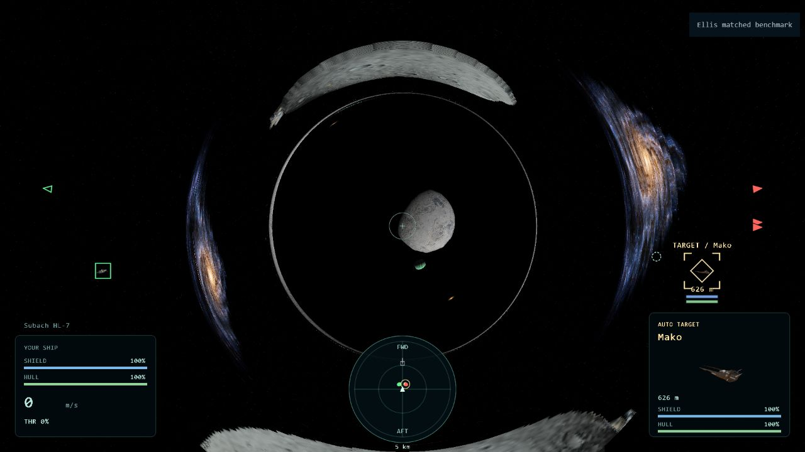

# Ellis bridge rendering experiment — 2026-10-23

The depth-aware prototype removes the asteroid's unconditional foreground
compositing. A single normalized Ellis integral lookup drives both sky direction
and finite-distance scene sampling. Two radial color/depth environment atlases
include the existing asteroid, mothership and fighter buffers. They update one
face per chart per frame by default, rather than rebuilding geometry.

These timings describe the initial geometry compositor, before the later throat
continuity repair documented in [Ellis bridge](../ellis-bridge.md).

## Matched measurements

Hardware-accelerated foreground Codex in-app browser, RTX 3070 Ti / ANGLE D3D11,
1280 × 720 CSS, DPR 1.5, 1920 × 1080 main backing. Seed 29, eight initial mixed
fighters, real artwork/materials, HUD, target camera and frame loop. Uncapped
flight setting, but observed cadence remains near the display's 75 Hz limit.
Two seconds warmup, then eight seconds sampled per run. No tests or asset builds
ran during these samples. The GPU timer extension was unavailable. Cold shader compilation, first atlas
fill and chart-transition spikes are excluded from the steady timing.

The first four samples use identical frozen simulation, zero-throttle player and
camera, in A/B/B/A order. Frozen sampling keeps actual renderer/HUD resources and
geometry; it is a rendering comparison, not a whole-game CPU benchmark. The
original default framebuffer uses browser MSAA; the new offscreen primary target
is single-sampled. That quality difference is another reason not to interpret
frame cadence as a fixed-quality GPU speedup.

| Run | Renderer / view | Mean frame | Frame p95 | Mean sky + scene CPU | CPU p95 | Scene draws | Submitted triangles |
| --- | --- | ---: | ---: | ---: | ---: | ---: | ---: |
| 1 | Original / approach A1 | 13.42 ms | 16.00 ms | 0.88 ms | 1.20 ms | 24 | 381733 |
| 2 | New rolling / approach B1 | 13.37 ms | 14.10 ms | 1.51 ms | 2.00 ms | 91 | 1212029 |
| 3 | New rolling / approach B2 | 13.55 ms | 18.60 ms | 1.46 ms | 1.90 ms | 91 | 1212029 |
| 4 | Original / approach A2 | 13.31 ms | 14.00 ms | 0.84 ms | 1.20 ms | 24 | 381733 |
| 5 | New rolling / rim | 13.43 ms | 19.30 ms | 1.31 ms | 1.70 ms | 91 | 1212029 |
| 6 | New rolling / return side | 13.33 ms | 18.10 ms | 1.29 ms | 1.80 ms | 91 | 1359245 |
| 7 | New all 12 faces / approach | 13.44 ms | 14.40 ms | 2.79 ms | 3.50 ms | 391 | 5252119 |
| 8 | New rolling / live combat | 13.50 ms | 19.70 ms | 2.16 ms | 3.40 ms | 148 | 1228540 |

Scene counts include repeated capture submissions and the compositor, but exclude
sky and target-camera draws. CPU includes the main presentation's sky and scene
calls, but excludes simulation, HUD and GPU completion. Median frame interval was
13.3 ms in every row. Occasional longer frames raise p95; the cadence cap means
these results do not establish maximum throughput or spare GPU budget.

The new rolling pass adds about 0.6 ms of combined submission CPU in the matched
approach. All-face updates increase this stage to 2.79 ms and submit 391 draws /
5.25 million triangles per frame, compared with 91 draws / 1.21 million triangles
for rolling updates. This supports retaining the rolling default on this setup;
it does not demonstrate a whole-game speedup or a GPU timing improvement.

The live run is a diagnostic with moving AI, weapons, effects and comms. Seven
fighters remained at sample end. Its composition evolves, so its 2.16 ms mean
presentation CPU is not directly subtractable from the frozen rows.

## Visual inspection

Reviewed real rendered captures at initial approach, oblique rim, return side and
with a fighter 100 m ahead of the camera. The near fighter remains in front of
the throat. The asteroid appears as curved images instead of painting across the
entire background mouth. Return-side images include the asteroid through the
bridge. Live rendering produced no new browser errors. A separate actual forward
crossing reached x = 12000 m at 70 m/s with the new renderer; the capture cache
switched charts successfully. A separate actual return crossing reached x = 0 m
at -70 m/s along Y. These qualitative traversals ran during repository checks
and are not included in the timing rows.



[Foreground fighter](ellis-foreground-2026-10-23.png),
[oblique rim](ellis-rim-2026-10-23.png),
[return side](ellis-moon-2026-10-23.png),
[actual arrival](ellis-transit-2026-10-23.png).

Visible limitations remain: captured silhouettes look coarse when strongly
magnified, high-order images are under-resolved, and the finite 2a lensing domain
creates an outer transition. The radial depth representation stores only the
nearest surface in each direction from a mouth; concave geometry, transparent
surfaces and very close flybys are approximations. Rolling updates can lag by six
rendered frames. Screen-space HUD targeting still uses ordinary positions.
This is a measured playtest prototype, not visual approval of every maneuver.

## Reproduce

Start the normal server, then run:

```
node tools/prepare-ellis-benchmark.cjs
```

Open `output/ellis-benchmark.html?mission=ellis&bridge=new&view=approach` on that
server and click Measure. `bridge=legacy` restores the original numerical sky-only
prototype; `bridge=sky` uses lookup sky without geometry compositing. `view=rim`,
`view=moon`, `view=foreground`, `bridgeFaces=6`, and `live=1` select the recorded
diagnostics. The generator writes only a development HTML harness under output;
the deployable flight page needs no package manager, build or runtime service.

Raw results and source fingerprints are in
[ellis-bridge-2026-10-23.json](ellis-bridge-2026-10-23.json).

## Checks

`npm run check` passed after implementation: strict types, asset/hull validation,
344 browser-native checks and the remaining dependency-free suite. Focused Ellis
optics, traversal and production capture/pose regressions also passed.
