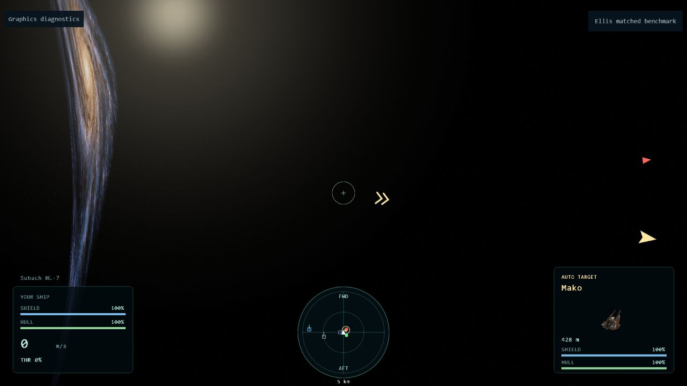

# Ellis context-loss isolation — 24 October 2026

The adaptive implicit-sampling geometry path reproduced context loss. Switching
its post-process shaders to explicit level-zero texture sampling is the current
mitigation. The driver/compiler fault itself has not been proven.

All isolation samples used the warped camera fixture, full backing resolution,
a 30 FPS cap, 2 seconds of warmup, and 8 seconds of collection. GPU timer queries
were disabled: these runs establish context stability, not rendering speed.

| Path | Result |
| --- | --- |
| Sky-only | 240 frames, zero loss events |
| Direct geometry | 240 frames, zero loss events |
| Captures, curved intersection bypassed | 240 frames, zero loss events |
| Full geometry, explicit sampling | 240 frames, zero loss events |
| Full geometry, implicit sampling | 240 frames, zero loss events |
| Adaptive geometry, explicit sampling | 240 frames, zero loss events |
| Adaptive geometry, implicit sampling | Context loss, invalid sample |

The failing run lost the main renderer, sky, HUD and target-camera contexts
nearly simultaneously, followed by partial restoration and another loss.
Seven logged canvas loss events do not mean seven independent GPU crashes.
Submission breadcrumbs are asynchronous and cannot identify the faulting draw.
No JavaScript shader compilation exception was established.

The old benchmark also emitted benign context-creation errors by asking an
existing WebGL1 canvas for WebGL2. Its instrumentation now uses known context
handles. This removes misleading noise without suppressing real loss events.

After isolation, a malformed test-craft orientation was corrected to an
orthonormal basis. Both subsequent explicit-sampling checks passed at
1920×1080: [static repeat](ellis-explicit-repeat-2026-10-24.json) and
[rapid camera rotation](ellis-explicit-moving-2026-10-24.json), 240 frames each.
The fixture change means those repeats supplement rather than replace the
original matched A/B evidence.

[Raw isolation runs and persistent event log](ellis-crash-isolation-2026-10-24.json).

Remaining validation: longer interactive play, throat crossings, and the opt-in
object-warp prototype. No object-warp performance or large-hull visual acceptance
is claimed by this investigation.
