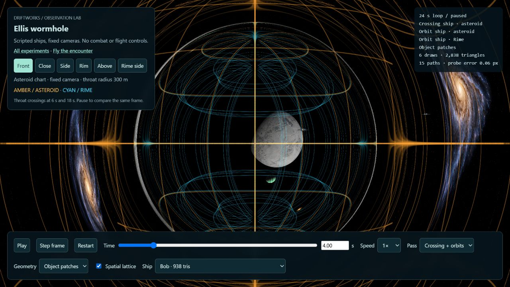
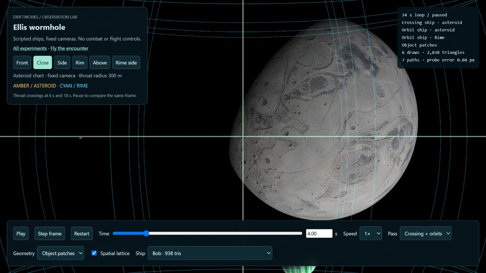
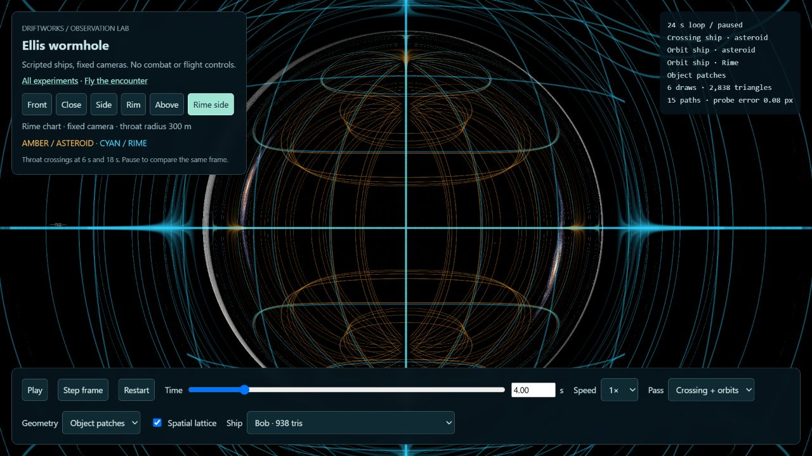

# Ellis spatial-lattice experiment — 24 October 2026

The grid is anchored to the two mouth charts, rather than to the screen. Five
wireframe spherical layers span approximately 300–600 m areal radius, with
30-degree angular spacing. The asteroid chart is amber and Rime is cyan.
The grid's light is sampled along the shared Ellis rays; its world pattern is
static. This is a spherical coordinate lattice, not a flat Cartesian volume.

## GPU check

A frozen seed-29 `view=transit` fixture observed the mouth from 400 m, with eight
actors and object-warp geometry. RTX 3070 Ti / ANGLE D3D11; 1920x1080 backing,
DPR 1.5, scale 1; 30 FPS cap. Each run used 2 seconds warmup and 8 seconds sample.
Order was off/on/on/off; no concurrent tests or asset generation during collection.

| Lattice | Frames | Mean sky query | Summed timed GPU work / frame |
| --- | --- | --- | --- |
| Off | 240 | 0.459 ms | 1.136 ms |
| On | 240 | 1.005 ms | 1.723 ms |
| On | 238 | 1.418 ms | 2.208 ms |
| Off | 240 | 0.600 ms | 1.453 ms |

The added sky cost was roughly 0.55–0.82 ms across the paired runs. GPU frequency
and background load were not pinned; the variation is visible in the baseline
as well. These are bounded scene measurements, not a universal cost or FPS gain.
Summed work includes completed queries from sky, geometry, target camera and HUD;
pending end-of-window queries can slightly undercount. No context losses or
disjoint-invalid samples occurred. Both modes submitted the same 37 geometry
draws and 404,009 triangles; the scaffold adds no mesh submission.

[Raw evidence](ellis-lattice-2026-10-24.json).

## Implementation and limits

Each pixel's curved ray intersects five radial shells analytically. Each shell
needs one extra integral-table sample, shared between incoming/outgoing hits.
The table is the existing cached 512-square Ellis LUT. The shader uses explicit
level-zero table sampling when EXT_shader_texture_lod is available. No new
scene capture, depth march, texture asset or runtime network dependency is added.
A subsequent pole safeguard avoids atan(0,0); the measurements predate only that
one-coordinate epsilon change.

Grid samples fade above 2.7 radians of angular travel and disappear at pi to
suppress strongly wound duplicates. Pixel width uses a local optical-span
estimate, excluding the chart storage offset. It remains approximate near
caustics and the polar convergence. Opaque meshes mask the sky-layer scaffold;
this is not exact near-grid/far-object depth ordering. The grid is an instrument
visualization, not collision geometry, a new physics model, or a ground-truth
embedding diagram.

The old camera-relative meridians and persistent THROAT TRANSIT box are removed.
Entry/crossing sounds, rumble and the short chart-crossing confirmation remain.

## Visual review

Reviewed front, close, rim and Rime-side cameras in the observation lab. The two
chart colors swap local/far roles while remaining world-anchored. The lab and
flight Settings provide a live toggle; `bridgeGrid=0` disables the scaffold.
This is an initial visual experiment: gameplay orientation benefit, motion
aliasing and preferred brightness still need the user's playtest.

