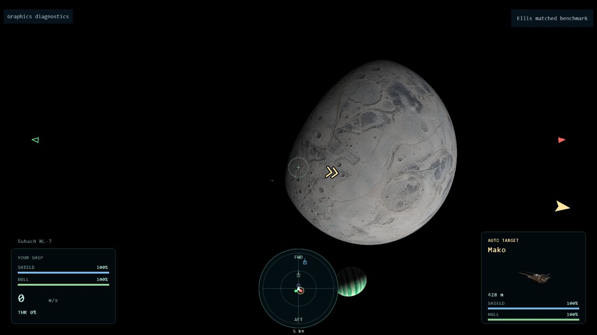

# Ellis object-patch experiment — 24 October 2026

The prototype is available at
`experiments/flight.html?mission=ellis&bridgeGeometry=objects`.
It retains the lensed sky and replaces per-pixel geometry intersection with
primary-path mesh patches. It remains opt-in.

## Matched GPU measurement

RTX 3070 Ti / ANGLE D3D11; 1920x1080 backing, DPR 1.5, scale 1; 30 FPS cap;
seed 29 frozen `view=warped` fixture, eight actors, observer at
(0,-2400,1550) m and a remote fighter at (12040,-1650,1570) m.
Each run used 2 seconds warmup and 8 seconds sample, in objects/full/full/objects
order. Camera, sky, effects and source assets were unchanged between modes.
The fighter was visible at the same approximate bearing in both captures;
its small silhouette is not a detailed shape-quality acceptance test.

| Mode | Timed GPU work per sampled frame | CPU frame work | Draws | Submitted triangles |
| --- | --- | --- | --- | --- |
| Full geometry | 6.67–6.88 ms | 1.35–1.39 ms | 94 | 1,212,029 |
| Object patches | 2.47–2.49 ms | 1.24–1.33 ms | 37 | 404,009 |

This is approximately 63% less measured GPU work. Frame cadence was capped;
these numbers do not establish an FPS multiplier. GPU cost is the sum of valid
completed timer-query durations across sky, geometry, target camera and HUD,
divided by sampled frames. Pending end-of-window queries can slightly undercount
work. No context losses or disjoint-invalid samples were recorded in these runs.
No concurrent tests or asset generation ran during collection.

The object scene used 30 CPU path solves across ten unique anchors, no captures,
and no geometry compositor. The largest fifth-probe error was 0.363 pixels.
The probe is one point, not a guarantee over every vertex. Draw-count differences
include the intentional removal of capture passes and per-craft batching.
Native PBR materials are replaced by the raw fallback in object mode, so some
material cost/appearance change is part of this prototype.

[Raw four-run evidence](ellis-objects-2026-10-24.json).

## Limits and next work

A patch is a 3D affine mapping of projected mesh vertices, with center plus
three offset solutions and a fifth error probe. It does not yet subdivide.
It cannot reproduce hull curvature across a strong lens gradient, all caustic
birth/death events, exact curved-space occlusion, or higher image branches.
Long capital hulls need error-driven patches that retain depth variation and
branch continuity. These timings do not establish a live 8v8 or capital-hull
performance budget. The existing numerical inverse/path continuity and real-mesh
submission regressions pass; the repository check passed before these benchmark
instrumentation-only changes.

## Live smoke check

A separate objects-mode transit fixture with forward flight and continuous fire
completed 239 sampled frames with zero context losses and no captured console
errors. The later frozen snapshot records 1,047 emitted shots and the player
at (12000,1726,1550) m, beyond the Rime mouth. This verifies execution through
traversal with active combat, not frame-by-frame visual continuity at the throat.
[Live sample](ellis-objects-live-2026-10-24.json) and
[post-transit state](ellis-objects-transit-state-2026-10-24.json).
